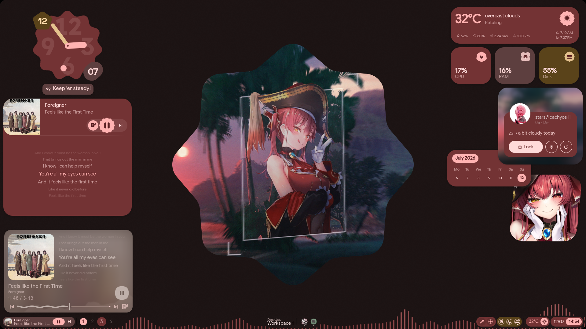

# myEndv-Ice

[Bahasa Indonesia](#bahasa-indonesia) | [English](#english) | [Screenshots](#screenshots) | [Credits](#credits)

---

## Screenshots

| Hyprland (`end4-pC`) | SekaiPop (`sekaipop`) |
|---|---|
|  |  |

| Liquid (`MacShell`) | MacLock |
|---|---|
|  |  |

---

## Bahasa Indonesia

Konfigurasi pribadi EndeavourOS + Hyprland (Lua config 0.55+) dengan dukungan multi-shell di Quickshell, keybind terpadu, audio Hi-Res PipeWire, dan skrip instalasi otomatis untuk pindah perangkat.

### Isi Repositori

- `hypr/`: `hyprland.lua`, `hypridle.conf`, `hyprlock.conf`, dan folder `custom/` berisi aturan jendela, autostart, keybind, serta skrip router di `custom/scripts/`.
- `swaync/`: tema dark frosted glass untuk notification center (`config.json`, `style.css`, `colors.css`).
- `pipewire/`: `10-hires-rates.conf` untuk membuka sample rate `44100` sampai `192000` Hz.
- `patches/MacShell/`: modifikasi `shell.qml` dan `MacBar.qml` (mengaktifkan `WindowBar` bawaan serta IPC `windecor` dan `appearance`).
- `pkglist.txt` & `flatpak.txt`: daftar paket `pacman`/`yay` dan aplikasi Flathub (`--user`).

Folder besar seperti `end4-pC`, `sekaipop`, `MacShell`, dan binary `.so` plugin Hyprland tidak disimpan di sini. Skrip `install.sh` mengunduh shell dari repositori aslinya saat pemasangan.

### Cara Pasang

```bash
git clone https://github.com/nyanky0/myEndv-Ice.git ~/myEndv-Ice
cd ~/myEndv-Ice
chmod +x install.sh
./install.sh
```

Skrip membuat cadangan folder `~/.config/hypr` dan `~/.config/swaync` terlebih dahulu sebelum menyalin file baru.

### Shortcut Utama (Multi-Shell)

| Shortcut | Fungsi |
|---|---|
| `SUPER + ALT + /` | Buka popup Shell Switcher (`Hyprland`, `SekaiPop`, `macOS`, `Liquid`) |
| `SUPER + Space` | Buka launcher sesuai shell aktif |
| `ALT + Space` | Buka search bar / Spotlight sesuai shell aktif |
| `SUPER + A` | Toggle sidebar / Control Center / QuickPanel |
| `SUPER + V` / `SUPER + .` | Clipboard history / Emoji picker |
| `SUPER + L` | Kunci layar (`MacLock`, `sekaipop`, `end4-pC`, atau `hyprlock`) |
| `SUPER + U` / `F12` | Toggle dropdown scratchpad Kate |
| `SUPER + E` | Buka atau fokuskan Nautilus (Spasi untuk peek via Sushi) |
| `SUPER + N` | Buka notification center SwayNC |
| `SUPER + ALT + N` | Toggle `WindowBar` di shell `Liquid` (`MacShell`) |
| `CTRL + SUPER + SHIFT + D` | Toggle mode gelap dan terang |

### Catatan Pasca-Instalasi

1. Kompilasi ulang plugin Hyprland (`hyprbars`, `Hyprspace`, `hyprfocus`, `hyprliquid`, `dynamic-cursors`) lewat `hyprpm` agar cocok dengan versi Hyprland di mesin baru.
2. Untuk koleksi FLAC lokal di drive eksternal, izinkan akses Flatpak Tauon ke folder tersebut:
   ```bash
   flatpak override --user --filesystem="/path/ke/folder/FLAC" com.github.taiko2k.tauonmb
   ```
3. File `monitors.lua` dan `workspaces.lua` tidak disertakan karena bergantung pada resolusi layar masing-masing perangkat.

---

## English

Personal EndeavourOS + Hyprland (Lua config 0.55+) setup with multi-shell switching in Quickshell, unified keybinds, PipeWire Hi-Res audio rates, and an install script for moving to a new machine.

### Repository Contents

- `hypr/`: `hyprland.lua`, `hypridle.conf`, `hyprlock.conf`, and `custom/` with window rules, autostart commands, keybinds, and router scripts under `custom/scripts/`.
- `swaync/`: dark frosted glass theme for the notification center (`config.json`, `style.css`, `colors.css`).
- `pipewire/`: `10-hires-rates.conf` enabling sample rates from `44100` up to `192000` Hz.
- `patches/MacShell/`: modified `shell.qml` and `MacBar.qml` enabling built-in `WindowBar` controls plus `windecor` and `appearance` IPC handlers.
- `pkglist.txt` & `flatpak.txt`: `pacman`/AUR package list and Flathub (`--user`) applications.

Large upstream directories (`end4-pC`, `sekaipop`, `MacShell`) and compiled Hyprland `.so` plugins are excluded from Git. `install.sh` pulls the upstream shells during installation.

### Installation

```bash
git clone https://github.com/nyanky0/myEndv-Ice.git ~/myEndv-Ice
cd ~/myEndv-Ice
chmod +x install.sh
./install.sh
```

The script backs up existing `~/.config/hypr` and `~/.config/swaync` directories before copying any files.

### Main Keybinds (Multi-Shell)

| Shortcut | Action |
|---|---|
| `SUPER + ALT + /` | Open Shell Switcher (`Hyprland`, `SekaiPop`, `macOS`, `Liquid`) |
| `SUPER + Space` | Open app launcher for the active shell |
| `ALT + Space` | Open search bar / Spotlight for the active shell |
| `SUPER + A` | Toggle sidebar / Control Center / QuickPanel |
| `SUPER + V` / `SUPER + .` | Clipboard history / Emoji picker |
| `SUPER + L` | Lock screen (`MacLock`, `sekaipop`, `end4-pC`, or `hyprlock`) |
| `SUPER + U` / `F12` | Toggle Kate dropdown scratchpad |
| `SUPER + E` | Open or focus Nautilus (Spacebar to peek via Sushi) |
| `SUPER + N` | Toggle SwayNC notification center |
| `SUPER + ALT + N` | Toggle `WindowBar` in `Liquid` (`MacShell`) |
| `CTRL + SUPER + SHIFT + D` | Toggle dark and light appearance |

### Post-Install Notes

1. Rebuild Hyprland plugins (`hyprbars`, `Hyprspace`, `hyprfocus`, `hyprliquid`, `dynamic-cursors`) using `hyprpm` so they match the installed Hyprland ABI.
2. For local FLAC libraries on external drives, grant Tauon Flatpak read access:
   ```bash
   flatpak override --user --filesystem="/path/to/FLAC" com.github.taiko2k.tauonmb
   ```
3. `monitors.lua` and `workspaces.lua` are omitted because display names and resolutions vary per machine.

---

## Credits

- [hyprwm/Hyprland](https://github.com/hyprwm/Hyprland) (Wayland compositor)
- [outfoxxed/quickshell](https://github.com/outfoxxed/quickshell) (Qt/QML shell framework)
- [end-4/dots-hyprland](https://github.com/end-4/dots-hyprland) (`end4-pC` base config & shell)
- [Blapples/SekaiPop](https://github.com/Blapples/SekaiPop) (`sekaipop` shell)
- [0-ss/MacShell](https://github.com/0-ss/MacShell) (`MacShell` & `MacLock`)
- [ErikReider/SwayNotificationCenter](https://github.com/ErikReider/SwayNotificationCenter) (`swaync`)
- [XiaoYouChR/Ghost-Downloader-3](https://github.com/XiaoYouChR/Ghost-Downloader-3) (multi-threaded downloader + browser extension)
- [Taiko2k/Tauon](https://github.com/Taiko2k/Tauon) (local Hi-Res FLAC player)
- [KRTirtho/Spotube](https://github.com/KRTirtho/Spotube) & [kipavy/spotube-plugin-lossless-sources](https://github.com/kipavy/spotube-plugin-lossless-sources) (streaming client + lossless plugin)
- [FreeRDP/Remmina](https://gitlab.com/Remmina/Remmina) & [rustdesk/rustdesk](https://github.com/rustdesk/rustdesk) (remote desktop clients)
